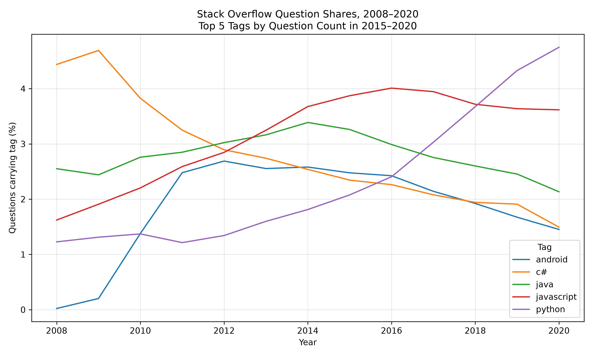

# Programming Language Popularity Analysis

## Goal
Explore Stack Overflow question activity by language and technology from 2008–2020 using Python.

## Analysis
- Percentage of questions carrying the 'R' tag in 2020.
- Five tags receiving the most questions during 2015–2020. 
- Yearly trends of the five tags from 2008-2020.

## Method
Load and inspect the data with pandas, rank tags by question count, calculate yearly percentages, and plot trends with matplotlib.
Question share (%) = num_questions / year_total × 100

## Results
- R question share in 2020: `0.966%`
- Top five tags during 2015–2020: `javascript`, `python`, `java`, `android`, `c#`

## Limitations
Question activity does not measure overall language usage or job demand.
Tags include technologies, not only programming languages.
A question can have multiple tags, so tag shares need not sum to 100%.
This historical dataset does not establish current popularity.

## Data Source
DataCamp: Analyze the Popularity of Programming Languages
https://www.datacamp.com/projects/2557

Input file: data/raw/stack_overflow_data.csv

## Run
Install the dependencies and run from this project's folder:

    python -m pip install -r requirements.txt
    python analysis.py