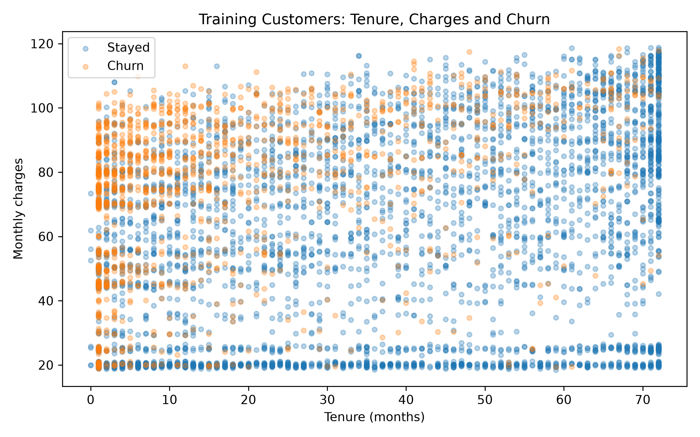
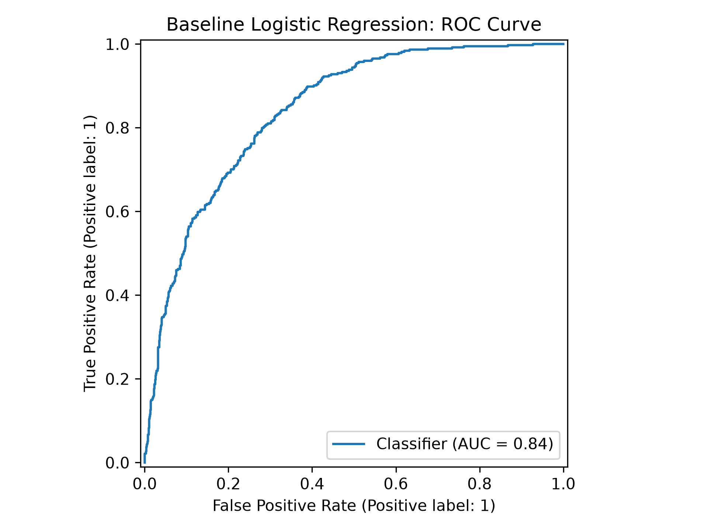

# Telecom Customer Churn: Logitic Regression
A Logistic Regression based Machine-Learning classifier that predicts whether a customer leaves a telecom service.

## Dataset
[IBM Telco Customer Churn dataset](https://github.com/IBM/telco-customer-churn-on-icp4d/blob/master/data/Telco-Customer-Churn.csv)

- 7,043 customer records and 21 columns
- Target: `Churn` - Yes = 1, No = 0
- `customerID` excluded from model inputs

## Workflow Implementation
1. Read CSV and convert `TotalCharges` to numeric. Blank values become missing values.
2. Split customers into 80% training and 20% test data, stratified by churn, with random_state=42
3. Fill missing charges using the training median. Fit one-hot encoding and numeric standardization on training data and apply the same transformations to test data.
4. Visualize tenure and monthly charges in the training set. 
5. Train and evaluate the original logistic-regression baseline. 
6. Apply zero-variance filtering, then RFE with 15 selected features. 
7. Compare balanced weights, custom weights `{0: 1, 1: 2}`, random undersampling, and SMOTENC. Sampling changes training data only. 
8. Print confusion matrices and the final metrics table; export the table to CSV.

## Analysis
- All methods use the same 1,409 held-out customers. 
- RFE uses 15 selected features; other methods use the full 30-feature representation.
- Class 1 is churn.

- Accuracy, precision, recall, F1, and ROC-AUC are calculated directly from each model's predictions.
- ROC-AUC uses churn probabilities.
- Confusion-matrix rows are actual labels and columns are predicted labels, in the order `[Stayed, Churned]`.

Results from a verification run on the source IBM CSV (rounded for display):
| Model | Accuracy | Precision | Recall | F1 | ROC-AUC |
|---|---:|---:|---:|---:|---:|
| Baseline | 0.806 | 0.657 | 0.559 | 0.604 | 0.842 |
| RFE | 0.796 | 0.634 | 0.543 | 0.585 | 0.841 |
| Balanced weights | 0.738 | 0.504 | 0.783 | 0.614 | 0.842 |
| Custom weights | 0.764 | 0.542 | 0.722 | 0.619 | 0.842 |
| Undersampling | 0.744 | 0.511 | 0.786 | 0.620 | 0.843 |
| SMOTENC | 0.742 | 0.510 | 0.770 | 0.613 | 0.832 |

## Key Findings
- The baseline achieved the highest accuracy and precision.
- Undersampling achieved the highest recall and F1.
- Higher recall came with more false positives.
- SMOTENC did not outperform simpler approaches.

Full-precision results can be viewed [here] (results/model_comparisons.csv)

## Visualization



## How to Run
Run these commands from this project's folder with your Python environment activated:

```bash
python -m pip install -r requirements.txt
mkdir -p results
python analysis.py
```

In PyCharm, make sure to set the run configuration's working directory to:
`Introductory/3_Telcomm_Customer_Churn`

## Limitations
- Models were compared on a repeatedly inspected test set.
- Future tuning should use training-only cross-validation.
- Class weights and the number of RFE features were not optimized.
- Business costs are needed to choose the appropriate precision–recall tradeoff.
- This implementation uses scikit-learn rather than implementing logistic regression from scratch.

## Skills Demonstrated

- Data cleaning and preprocessing
- One-hot encoding and standardization
- Logistic Regression using scikit-learn
- Feature selection using VarianceThreshold and RFE
- Class weighting, undersampling, and SMOTENC